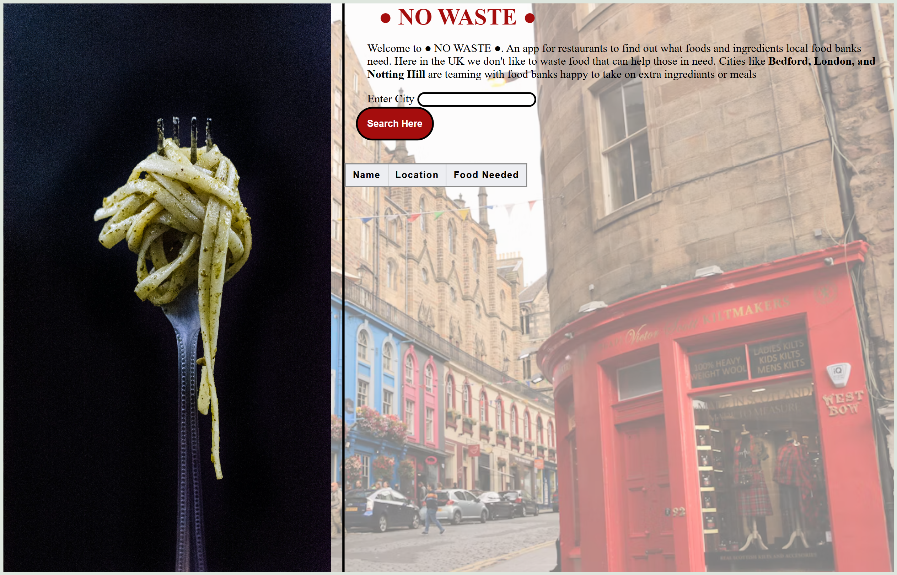

# 🍽️ Project: Simple API 2 - Restaurant

### Goal: Build a simple front-end app that displays data returned from an api that would be beneficial to someone working at or managing a restaurant. 

## Project Description

An app for restaurants in the United Kingdom to find out what foods and ingredients local food banks need. In the UK we don't like to waste food that can help those in need. Cities like Bedford, London, and Notting Hill are teaming with food banks happy to take on extra ingrediants or meals

It uses https://www.givefood.org.uk/ API and takes in a city then retrieves the local food banks, their address, and the food that bank needs. This is helpful for restaurant employees who want to give away food and confirm that the food bank will accept it.

The application displays the local food banks, their address, and the food that bank needs.

## Tech Stack

- **HTML** 
- **CSS**
- **JavaScript**

## How to Run or View It

1. Clone or download the repository.
2. Open `index.html` in a browser or serve the project using a local development server.
3. Input a city in the UK.
4. Click **search here** to retrieve the local food bank information.

The application requires an internet connection to access its external APIs. API availability and credential requirements may affect the results.

## Screenshots and Demo

### Application Interface

.png)

The interface displays the local food banks, their address, and the food that bank needs.